# Lost and Found

A helper that sits on top of your screen and tells you what you did not know to look for.

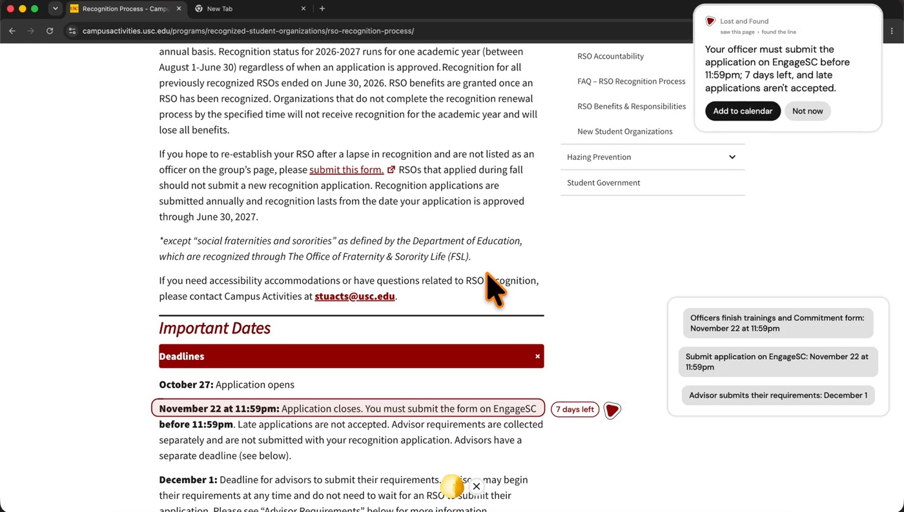

Built in one weekend at the AI@USC hackathon, November 14 to 15, 2026. In this repository its code name is `paral`.

## The problem

USC has a page for almost everything: clubs, funding, study abroad, registration, financial aid. They live on
different sites, and the part that matters is often folded inside a section you have to click to open.

Search and chatbots help once you know the question. Most misses happen before that. The club recognition page
keeps its deadline inside a closed section, and late applications are not accepted. The Catalina Maymester page
still shows its "Apply" button under a deadline that has passed. Nobody asks about a date they do not know exists.

## What it does

Lost and Found has no window of its own. It rests as a small orb at the bottom of the screen and reads the page
you have open.

- **It speaks first.** On a USC page it has read ahead of time, it says the one thing that will cost you later:
  a date still ahead, a step that is required, a deadline that has passed. Once, in one sentence, with a mark on
  the line.
- **You can ask out loud.** Hold the right Option key, ask, and let go. It answers in short sentences and draws
  on your page: a ring, a box, "7 days left", a line through a date that has gone.
- **It walks you through.** Say "show me" and it takes the steps one at a time. The step you are on is marked
  "Next". Click it and it is ticked "Done".
- **It does the next thing when you say so.** On a page it knows, an answer stays on a card with one main button:
  add the date to your calendar, open the closed section, walk the steps, or go to the USC page that covers what
  you asked. An arrow that points off screen carries its own button to scroll there for you.
- **It draws the whole picture.** Ask it to draw everything you have to do, in order, and it lays the steps out
  as a map beside the page.
- **On your own homework it tutors.** It gives one hint at a time, rings the part of the problem the hint is
  about, and keeps the answer for you to find.
- **It gives you your notes.** Say "show me my notes" and it writes one page: what you asked for, the steps in
  order, which are done, and where each one is.

## Where it fits

It slots into whatever page is on the screen. On a page it has read ahead of time it speaks first. Anywhere
else it waits to be asked, and answers about what is in front of you.

### One sitting on one page

<table>
<tr>
<td width="50%">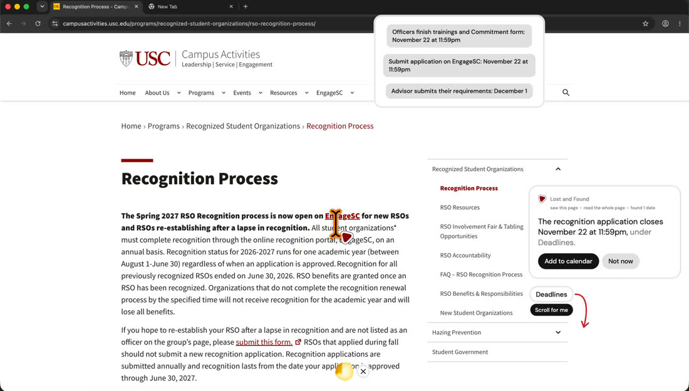<br><b>1. It speaks first.</b> The page has just loaded. A card says the application closes November 22, lists what is still ahead, and points down to where the date is.</td>
<td width="50%"><br><b>2. It finds the line.</b> The date sits inside a closed section. Once it is open, the line is boxed with "7 days left" and a button to put it in your calendar.</td>
</tr>
<tr>
<td>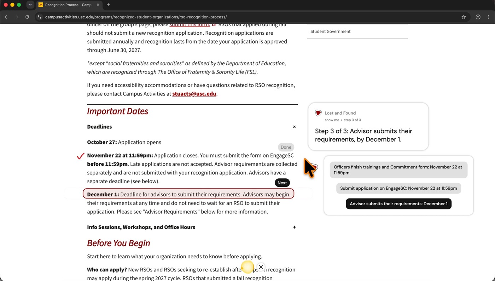<br><b>3. "Show me."</b> It walks the steps one at a time. The one behind you is ticked "Done", the one you are on is marked "Next".</td>
<td>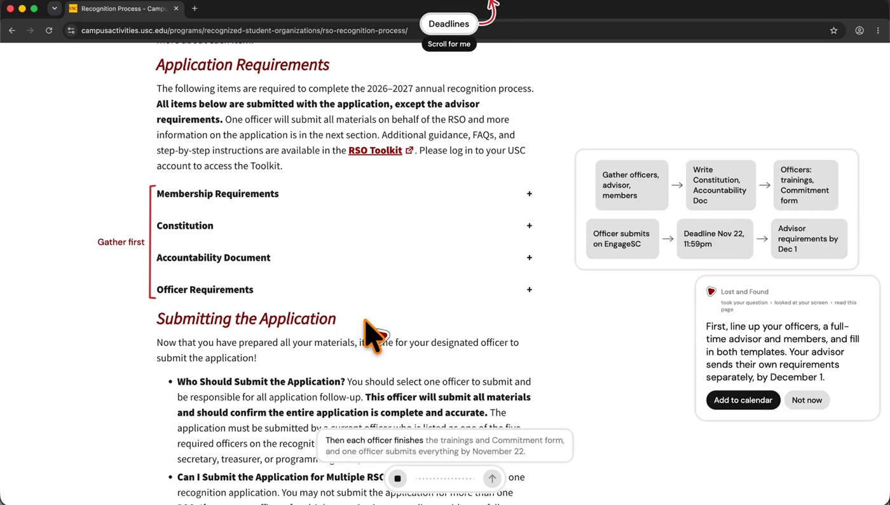<br><b>4. "Draw everything I have to do, in order."</b> It lays the whole process out as a map, and brackets the sections of the page that belong to the first step.</td>
</tr>
</table>

### Across USC's own pages

Each of these is a different office's page, and on each it marked the one thing to act on.

<table>
<tr>
<td width="50%">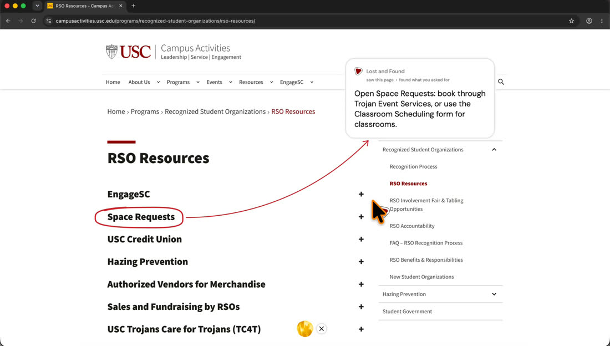<br><b>Booking a room for a club.</b> Asked where to book, it sent the student to the RSO Resources page and ringed "Space Requests" when the page arrived.</td>
<td width="50%">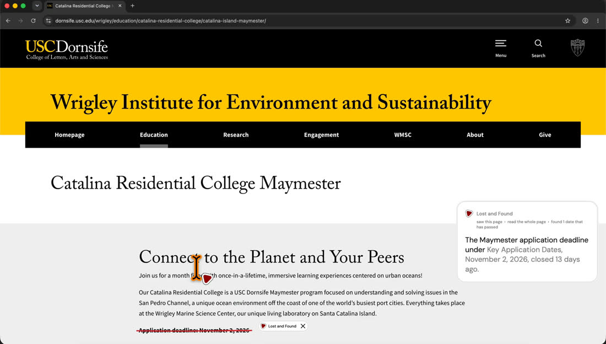<br><b>A program you meant to apply for.</b> The Maymester deadline is struck through: closed 13 days ago, above an "Apply" button that still shows.</td>
</tr>
<tr>
<td>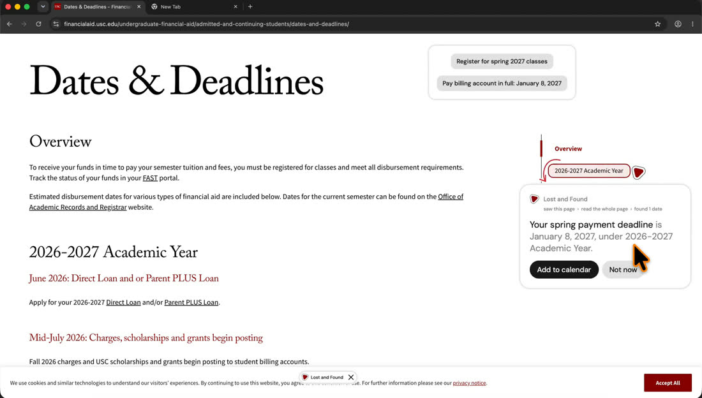<br><b>Paying for spring.</b> On the financial aid dates page: your billing account must be paid in full by January 8.</td>
<td>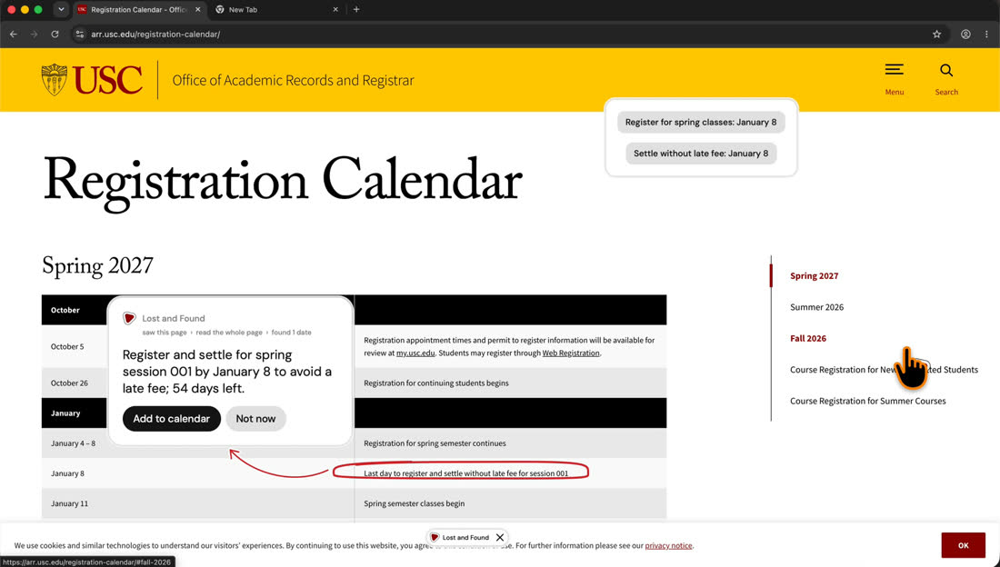<br><b>Registering on time.</b> On the registration calendar it rings one row out of dozens: the last day to register without a late fee, 54 days left.</td>
</tr>
<tr>
<td>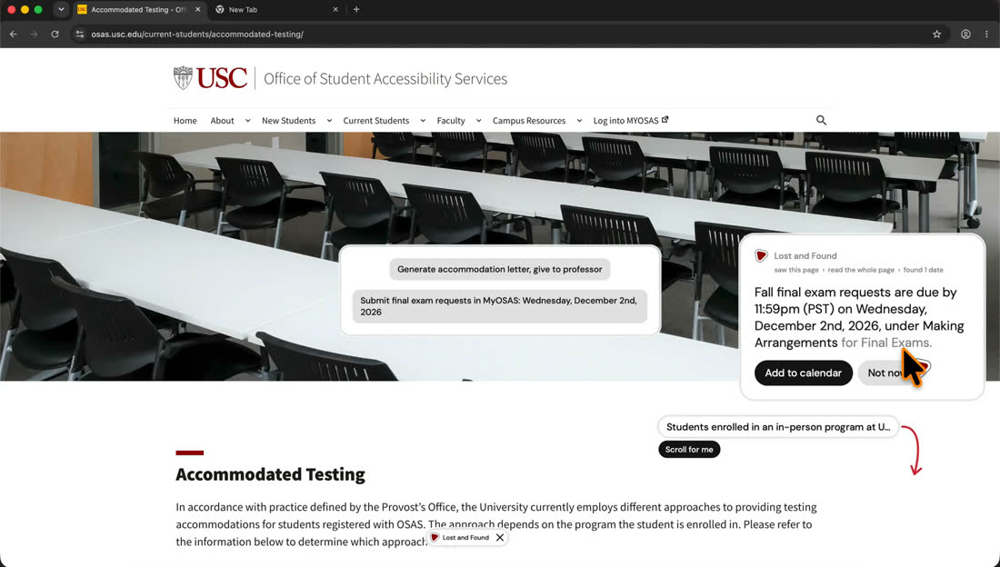<br><b>Exam accommodations.</b> Final exam requests are due December 2 at 11:59 pm, and it lists the two things to do before then.</td>
<td>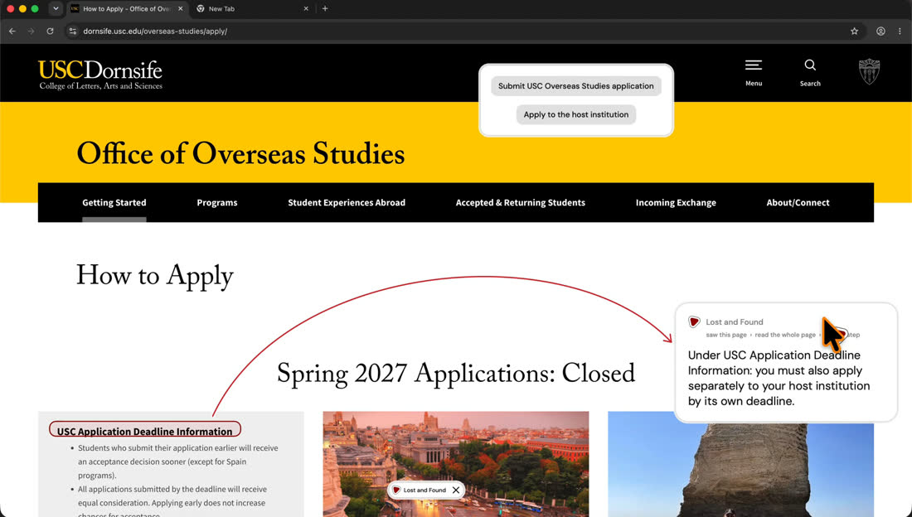<br><b>Studying abroad.</b> The step people miss: besides the USC application, you apply to the host institution by its own deadline.</td>
</tr>
</table>

Any office's page can join these by adding its address to one list (see "Add a page").

### On your own work

It does not need to know a page ahead of time to help with it. Hold the key and ask.

<table>
<tr>
<td width="50%">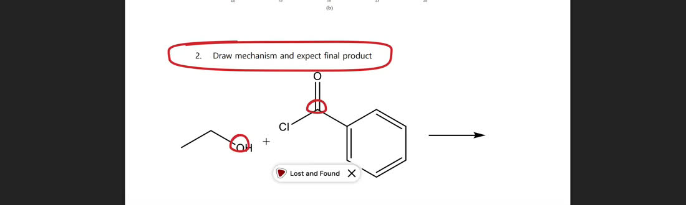<br><b>A chemistry worksheet.</b> Asked for the final product, it gives a hint instead and rings the two atoms the hint is about, on the drawing itself.</td>
<td width="50%">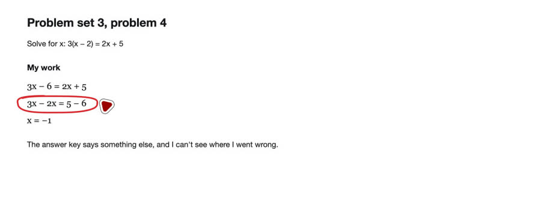<br><b>A step that went wrong.</b> It rings the line to look at again and says where to look, not what the mistake is. Ask again and the hint goes one level deeper.</td>
</tr>
<tr>
<td>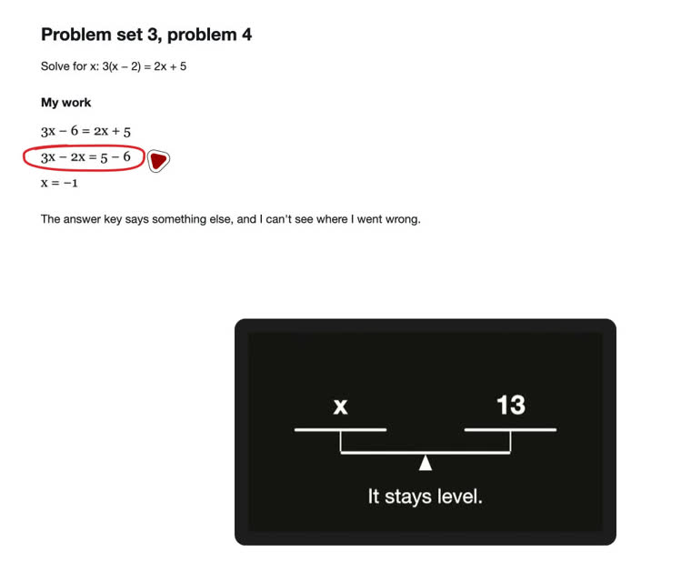<br><b>"Show me why that works."</b> A short clip plays beside the work: the idea, on numbers that are not yours.</td>
<td>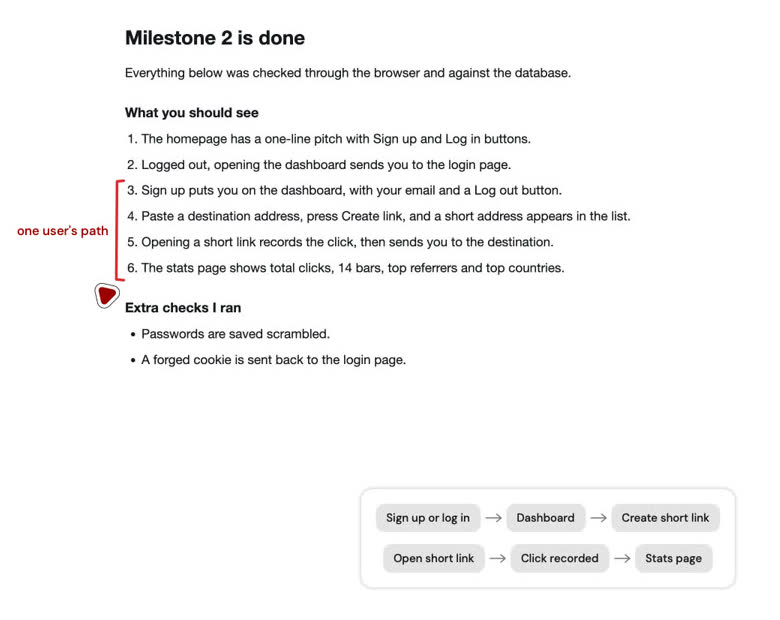<br><b>Your own project notes.</b> Asked how the pieces connect, it brackets the lines it means and draws the flow as a board.</td>
</tr>
</table>

*The pictures of USC pages and the worksheet are frames of the app running on a Mac, driven by a script. The last
three are drawn by the app's own drawing code in its tests.*

### Things to say

| Say or tap | What happens |
|---|---|
| nothing | on a page it knows, it tells you the one date or step that matters |
| any question, with the right Option key held | a short answer aloud, with the line it means marked on your page |
| "show me" | the steps, one at a time, each marked where it is |
| "add it to my calendar" | the date opens in your calendar, ready to add |
| "scroll for me" | the page turns to what it is pointing at |
| "open it for me" | the closed section it has marked is opened with one click |
| "take me there" | the USC page it just named opens, with the right part ringed |
| "draw everything I have to do, in order" | a map of the whole process beside the page |
| "just tell me the answer", on your own work | the next hint |
| "show me my notes" | one page of what you asked for, the steps, and which are done |

## How it works

Two programs and one narrow channel between them.

- **The Mac side** (`body/`, Swift) sees, hears, draws and speaks. It pictures the display, reads the words on it
  with Apple's text recognition, records the microphone, and draws in a see-through window that lets clicks pass
  to the page underneath. It knows nothing about AI models.
- **The thinking side** (`mind/`, TypeScript on Node, no build step) decides what to say and what to mark. It
  works in lines of text and the boxes they sit in, and knows nothing about pixels.
- **The channel** (`seam/`) is one file listing every message either side may send. Anything else is refused.

A few choices do most of the work.

- **The AI never says where anything is.** It quotes the line it means, and code finds that line among the words
  read off the screen. If the quote is not there, nothing is drawn.
- **It knows the pages before you open them.** The pages it covers are named in one list, `pages/list.json`, 24
  of them today. Each is read ahead with its closed sections and kept as text with the day it was read.
- **Speaking first sends nothing from your screen.** The screen is read on the Mac. When it matches a page on
  the list, the AI is asked about the kept copy of that page and today's date. The answer is the same all day,
  so it is asked once and kept. The card shows about a hundredth of a second after the page is read.
- **Two rules are enforced in code after the AI answers.** A date that is on neither your screen nor a page it
  has read is not said. On your own work, a hint that holds the result is dropped and a safer one is said.
- **Two models, each for what it is good at.** A fast one drafts the first line while you are still talking, so
  it speaks within a second of letting go. A deeper one writes the answer, which begins four to five seconds
  after.
- **A spoken sentence is kept short.** A sentence is measured by its letters as well as its words and cut where
  both halves still stand. In the last pass none of 72 answers had a sentence over eight seconds; one with no
  clean place to cut is said whole.
- **Nothing is a magic number.** Every setting carries its reason and what was measured. Every colour, size and
  timing of the look sits in one file with a page of dials, so a new look slots in without touching code.

A question costs two to three cents of AI time. Reading all 24 pages ahead costs about sixty cents a day, and
those readings hold nothing about any student.

## What it sees, sends and keeps

| When | What leaves the Mac | Where it goes |
|---|---|---|
| You hold the key and ask | the sound of your question | Cartesia, to be heard |
| | your words and the text read off the screen | Anthropic, for the first line |
| | one picture of the display, its text and the question | Anthropic, for the answer |
| It answers | each sentence | Cartesia, to be spoken |
| It speaks first on a page it knows | its own kept copy of that page, and the date | Anthropic |
| | the one sentence it says aloud | Cartesia, to be spoken |
| It looks at any other page | nothing | |

Its own windows are left out of every picture. It has no account and keeps no history between runs. While it
runs, the newest picture of the screen and, for the notes page, cut-outs of the sections it marked sit in the
Mac's temporary folder and nowhere else. It acts in
another app only when asked: it opens an https page on usc.edu, turns the scroll wheel, or clicks one closed
heading it has itself marked. It never types.

## Run it

Needs macOS 14 or later, the Xcode command line tools and Node 26. Keys for Claude and Cartesia go in
`~/.config/paral/keys.env`; `keys.env.example` lists the names. No key lives in this folder.

```sh
npm install
./check   # builds the Mac side and runs every check; needs no key, microphone or screen
./run     # says which permissions macOS will ask for, then starts it
./tune    # a page of dials for every colour, size and motion time
```

macOS asks for the microphone and for screen recording. It asks for Accessibility only if you tell the app to
scroll or open something for you. Everything else works without it.

Open a page from the list, for example the
[club recognition page](https://campusactivities.usc.edu/programs/recognized-student-organizations/rso-recognition-process/),
and give it a second. Then hold the right Option key and ask. Hold Shift as well to draw around something.

## Add a page

```sh
# 1. add {"name": "my-office", "url": "https://my-office.usc.edu/dates/"} to pages/list.json
node pages/gather.ts my-office   # 2. reads that page and keeps its text
```

The next time the app starts it knows the page. If the page holds a date or a required step, it speaks first
there. `node pages/gather.ts` with no name reads every page on the list again.

## How it is checked

- **`./check`** runs one test file over the rows in `test/rows/`. Each row is a small data file stating one
  thing that must be true. It needs no key, microphone or screen.
- **`exam/`** is a separate judge that imports nothing from the app. It plays 24 scripted students through the
  real AI and voice, films what the app draws, and reads every frame. Is the mark on the line it named? Does ink
  cover any words? Was every date on a page it had read? Did the tutor give the answer away? On the last build
  of the weekend, 1,912 of 1,914 checks pass. The two that do not are a true date shown as "December first"
  where the page writes "December 1".
- **On a real screen** it has been recorded speaking first on six USC pages, answering spoken questions,
  walking three steps by clicks, and ringing the atoms on a chemistry worksheet. "Scroll for me" has been pressed
  there, and the mark then landed on its line; whether the app's own scrolling moved the page that time is not
  confirmed.

The judge found real faults over the weekend, and each became a row before it was fixed: a date written in
words that the date rule could not read, a question in a page's first second that silenced the page, sentences
that took too long to say.

## What it does not do yet

- It runs on a Mac only.
- It needs your own keys in a file. A campus version would keep them on a server.
- It speaks first only on a page you have open. It can send you on to another page it knows. It cannot yet tell
  you about one you never visit.
- It remembers one sitting. Close it and it starts over.
- The kept pages are as fresh as their last reading. Reading them again every night is the next step.
- "Open it for me", "Take me there" pressed and the notes page run in tests and have not yet run on a real
  screen. "Scroll for me" has been pressed there and "Add to calendar" has written its date there;
  neither has been filmed, and the scrolling itself is not yet confirmed on a real screen.
- It does not work with a screen reader. Every spoken sentence is also shown as text, the demo's questions can be
  tapped from the menu, and it follows the Mac's Reduce Motion setting.

## Where things are

| Folder | What it holds |
|---|---|
| `body/` | the Mac app: capture, text reading, the overlay, the voice |
| `mind/` | what to say and what to mark: the turn, the looks, the hint ladder, the two rules |
| `seam/` | the one list of messages between the two |
| `pages/` | the list of USC pages and their kept text |
| `test/` | the rows and the one test file |
| `exam/` | the separate judge and its 24 scenarios |
| `lessons/`, `dials/` | the short lesson clips, and the dials page |

`CLAUDE.md` describes each part and how to add one. No file in the app is longer than 219 lines, and a check
keeps it that way.

## Built with

Swift (AppKit, ScreenCaptureKit, Vision, AVFoundation) · TypeScript on Node · Claude Opus 5.5 and Haiku 5.5
through the Anthropic SDK · Cartesia for hearing and speaking · zod · raea for the lesson clips · DialKit for
the dials.
